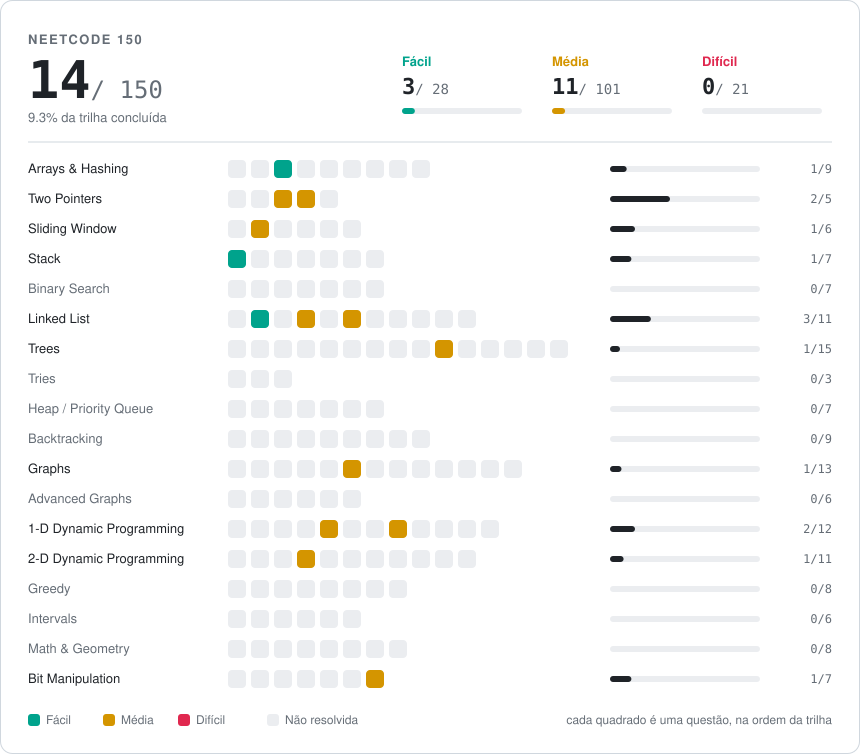

# NeetCode 150

Minhas soluções da trilha [NeetCode 150](https://neetcode.io/practice), na ordem oficial.

<p align="center">
  <picture>
    <source media="(prefers-color-scheme: dark)" srcset="assets/progress-dark.svg">
    
  </picture>
</p>

## Como funciona

O progresso é **automático**. Não precisa marcar nada à mão: a cada push, uma
GitHub Action roda `scripts/update_progress.py`, que procura no repositório
arquivos ou pastas cujo nome contém o nome da questão (maiúsculas, hífens e `_`
são ignorados) e atualiza
a imagem acima e as tabelas abaixo.

Exemplos de nomes que funcionam:

```text
1-TwoSum.py
0217-contains-duplicate.cpp
two-pointers/0011-container-with-most-water.py
3-two-sum/            (pasta)
```

Para atualizar localmente sem esperar a Action: `python3 scripts/update_progress.py`.

## Questões

<!-- PROGRESS:START -->

<details>
<summary><b>Arrays & Hashing</b> — 1/9</summary>

| # | Questão | Dificuldade | Solução |
|--:|---------|-------------|---------|
| 1 | [Contains Duplicate](https://leetcode.com/problems/contains-duplicate/) | 🟢 Fácil |  |
| 2 | [Valid Anagram](https://leetcode.com/problems/valid-anagram/) | 🟢 Fácil |  |
| 3 | [Two Sum](https://leetcode.com/problems/two-sum/) | 🟢 Fácil | ✅ [código](1-TwoSum.py) |
| 4 | [Group Anagrams](https://leetcode.com/problems/group-anagrams/) | 🟡 Média |  |
| 5 | [Top K Frequent Elements](https://leetcode.com/problems/top-k-frequent-elements/) | 🟡 Média |  |
| 6 | [Product of Array Except Self](https://leetcode.com/problems/product-of-array-except-self/) | 🟡 Média |  |
| 7 | [Valid Sudoku](https://leetcode.com/problems/valid-sudoku/) | 🟡 Média |  |
| 8 | [Encode and Decode Strings](https://leetcode.com/problems/encode-and-decode-strings/) | 🟡 Média |  |
| 9 | [Longest Consecutive Sequence](https://leetcode.com/problems/longest-consecutive-sequence/) | 🟡 Média |  |

</details>

<details>
<summary><b>Two Pointers</b> — 1/5</summary>

| # | Questão | Dificuldade | Solução |
|--:|---------|-------------|---------|
| 10 | [Valid Palindrome](https://leetcode.com/problems/valid-palindrome/) | 🟢 Fácil |  |
| 11 | [Two Sum II - Input Array Is Sorted](https://leetcode.com/problems/two-sum-ii-input-array-is-sorted/) | 🟡 Média |  |
| 12 | [3Sum](https://leetcode.com/problems/3sum/) | 🟡 Média |  |
| 13 | [Container With Most Water](https://leetcode.com/problems/container-with-most-water/) | 🟡 Média | ✅ [código](11-ContainerWithMostWater.py) |
| 14 | [Trapping Rain Water](https://leetcode.com/problems/trapping-rain-water/) | 🔴 Difícil |  |

</details>

<details>
<summary><b>Sliding Window</b> — 1/6</summary>

| # | Questão | Dificuldade | Solução |
|--:|---------|-------------|---------|
| 15 | [Best Time to Buy and Sell Stock](https://leetcode.com/problems/best-time-to-buy-and-sell-stock/) | 🟢 Fácil |  |
| 16 | [Longest Substring Without Repeating Characters](https://leetcode.com/problems/longest-substring-without-repeating-characters/) | 🟡 Média | ✅ [código](3-LongestSubstringWithoutRepeatingCharacters.py) |
| 17 | [Longest Repeating Character Replacement](https://leetcode.com/problems/longest-repeating-character-replacement/) | 🟡 Média |  |
| 18 | [Permutation in String](https://leetcode.com/problems/permutation-in-string/) | 🟡 Média |  |
| 19 | [Minimum Window Substring](https://leetcode.com/problems/minimum-window-substring/) | 🔴 Difícil |  |
| 20 | [Sliding Window Maximum](https://leetcode.com/problems/sliding-window-maximum/) | 🔴 Difícil |  |

</details>

<details>
<summary><b>Stack</b> — 0/7</summary>

| # | Questão | Dificuldade | Solução |
|--:|---------|-------------|---------|
| 21 | [Valid Parentheses](https://leetcode.com/problems/valid-parentheses/) | 🟢 Fácil |  |
| 22 | [Min Stack](https://leetcode.com/problems/min-stack/) | 🟡 Média |  |
| 23 | [Evaluate Reverse Polish Notation](https://leetcode.com/problems/evaluate-reverse-polish-notation/) | 🟡 Média |  |
| 24 | [Generate Parentheses](https://leetcode.com/problems/generate-parentheses/) | 🟡 Média |  |
| 25 | [Daily Temperatures](https://leetcode.com/problems/daily-temperatures/) | 🟡 Média |  |
| 26 | [Car Fleet](https://leetcode.com/problems/car-fleet/) | 🟡 Média |  |
| 27 | [Largest Rectangle in Histogram](https://leetcode.com/problems/largest-rectangle-in-histogram/) | 🔴 Difícil |  |

</details>

<details>
<summary><b>Binary Search</b> — 0/7</summary>

| # | Questão | Dificuldade | Solução |
|--:|---------|-------------|---------|
| 28 | [Binary Search](https://leetcode.com/problems/binary-search/) | 🟢 Fácil |  |
| 29 | [Search a 2D Matrix](https://leetcode.com/problems/search-a-2d-matrix/) | 🟡 Média |  |
| 30 | [Koko Eating Bananas](https://leetcode.com/problems/koko-eating-bananas/) | 🟡 Média |  |
| 31 | [Find Minimum in Rotated Sorted Array](https://leetcode.com/problems/find-minimum-in-rotated-sorted-array/) | 🟡 Média |  |
| 32 | [Search in Rotated Sorted Array](https://leetcode.com/problems/search-in-rotated-sorted-array/) | 🟡 Média |  |
| 33 | [Time Based Key-Value Store](https://leetcode.com/problems/time-based-key-value-store/) | 🟡 Média |  |
| 34 | [Median of Two Sorted Arrays](https://leetcode.com/problems/median-of-two-sorted-arrays/) | 🔴 Difícil |  |

</details>

<details>
<summary><b>Linked List</b> — 1/11</summary>

| # | Questão | Dificuldade | Solução |
|--:|---------|-------------|---------|
| 35 | [Reverse Linked List](https://leetcode.com/problems/reverse-linked-list/) | 🟢 Fácil |  |
| 36 | [Merge Two Sorted Lists](https://leetcode.com/problems/merge-two-sorted-lists/) | 🟢 Fácil |  |
| 37 | [Reorder List](https://leetcode.com/problems/reorder-list/) | 🟡 Média |  |
| 38 | [Remove Nth Node From End of List](https://leetcode.com/problems/remove-nth-node-from-end-of-list/) | 🟡 Média |  |
| 39 | [Copy List With Random Pointer](https://leetcode.com/problems/copy-list-with-random-pointer/) | 🟡 Média |  |
| 40 | [Add Two Numbers](https://leetcode.com/problems/add-two-numbers/) | 🟡 Média | ✅ [código](2-AddTwoNumbers.py) |
| 41 | [Linked List Cycle](https://leetcode.com/problems/linked-list-cycle/) | 🟢 Fácil |  |
| 42 | [Find the Duplicate Number](https://leetcode.com/problems/find-the-duplicate-number/) | 🟡 Média |  |
| 43 | [LRU Cache](https://leetcode.com/problems/lru-cache/) | 🟡 Média |  |
| 44 | [Merge K Sorted Lists](https://leetcode.com/problems/merge-k-sorted-lists/) | 🔴 Difícil |  |
| 45 | [Reverse Nodes in K-Group](https://leetcode.com/problems/reverse-nodes-in-k-group/) | 🔴 Difícil |  |

</details>

<details>
<summary><b>Trees</b> — 1/15</summary>

| # | Questão | Dificuldade | Solução |
|--:|---------|-------------|---------|
| 46 | [Invert Binary Tree](https://leetcode.com/problems/invert-binary-tree/) | 🟢 Fácil |  |
| 47 | [Maximum Depth of Binary Tree](https://leetcode.com/problems/maximum-depth-of-binary-tree/) | 🟢 Fácil |  |
| 48 | [Diameter of Binary Tree](https://leetcode.com/problems/diameter-of-binary-tree/) | 🟢 Fácil |  |
| 49 | [Balanced Binary Tree](https://leetcode.com/problems/balanced-binary-tree/) | 🟢 Fácil |  |
| 50 | [Same Tree](https://leetcode.com/problems/same-tree/) | 🟢 Fácil |  |
| 51 | [Subtree of Another Tree](https://leetcode.com/problems/subtree-of-another-tree/) | 🟢 Fácil |  |
| 52 | [Lowest Common Ancestor of a Binary Search Tree](https://leetcode.com/problems/lowest-common-ancestor-of-a-binary-search-tree/) | 🟡 Média |  |
| 53 | [Binary Tree Level Order Traversal](https://leetcode.com/problems/binary-tree-level-order-traversal/) | 🟡 Média |  |
| 54 | [Binary Tree Right Side View](https://leetcode.com/problems/binary-tree-right-side-view/) | 🟡 Média |  |
| 55 | [Count Good Nodes in Binary Tree](https://leetcode.com/problems/count-good-nodes-in-binary-tree/) | 🟡 Média | ✅ [código](1148-CountGoodNodesInBinaryTree.py) |
| 56 | [Validate Binary Search Tree](https://leetcode.com/problems/validate-binary-search-tree/) | 🟡 Média |  |
| 57 | [Kth Smallest Element in a BST](https://leetcode.com/problems/kth-smallest-element-in-a-bst/) | 🟡 Média |  |
| 58 | [Construct Binary Tree from Preorder and Inorder Traversal](https://leetcode.com/problems/construct-binary-tree-from-preorder-and-inorder-traversal/) | 🟡 Média |  |
| 59 | [Binary Tree Maximum Path Sum](https://leetcode.com/problems/binary-tree-maximum-path-sum/) | 🔴 Difícil |  |
| 60 | [Serialize and Deserialize Binary Tree](https://leetcode.com/problems/serialize-and-deserialize-binary-tree/) | 🔴 Difícil |  |

</details>

<details>
<summary><b>Tries</b> — 0/3</summary>

| # | Questão | Dificuldade | Solução |
|--:|---------|-------------|---------|
| 61 | [Implement Trie (Prefix Tree)](https://leetcode.com/problems/implement-trie-prefix-tree/) | 🟡 Média |  |
| 62 | [Design Add and Search Words Data Structure](https://leetcode.com/problems/design-add-and-search-words-data-structure/) | 🟡 Média |  |
| 63 | [Word Search II](https://leetcode.com/problems/word-search-ii/) | 🔴 Difícil |  |

</details>

<details>
<summary><b>Heap / Priority Queue</b> — 0/7</summary>

| # | Questão | Dificuldade | Solução |
|--:|---------|-------------|---------|
| 64 | [Kth Largest Element in a Stream](https://leetcode.com/problems/kth-largest-element-in-a-stream/) | 🟢 Fácil |  |
| 65 | [Last Stone Weight](https://leetcode.com/problems/last-stone-weight/) | 🟢 Fácil |  |
| 66 | [K Closest Points to Origin](https://leetcode.com/problems/k-closest-points-to-origin/) | 🟡 Média |  |
| 67 | [Kth Largest Element in an Array](https://leetcode.com/problems/kth-largest-element-in-an-array/) | 🟡 Média |  |
| 68 | [Task Scheduler](https://leetcode.com/problems/task-scheduler/) | 🟡 Média |  |
| 69 | [Design Twitter](https://leetcode.com/problems/design-twitter/) | 🟡 Média |  |
| 70 | [Find Median From Data Stream](https://leetcode.com/problems/find-median-from-data-stream/) | 🔴 Difícil |  |

</details>

<details>
<summary><b>Backtracking</b> — 0/9</summary>

| # | Questão | Dificuldade | Solução |
|--:|---------|-------------|---------|
| 71 | [Subsets](https://leetcode.com/problems/subsets/) | 🟡 Média |  |
| 72 | [Combination Sum](https://leetcode.com/problems/combination-sum/) | 🟡 Média |  |
| 73 | [Permutations](https://leetcode.com/problems/permutations/) | 🟡 Média |  |
| 74 | [Subsets II](https://leetcode.com/problems/subsets-ii/) | 🟡 Média |  |
| 75 | [Combination Sum II](https://leetcode.com/problems/combination-sum-ii/) | 🟡 Média |  |
| 76 | [Word Search](https://leetcode.com/problems/word-search/) | 🟡 Média |  |
| 77 | [Palindrome Partitioning](https://leetcode.com/problems/palindrome-partitioning/) | 🟡 Média |  |
| 78 | [Letter Combinations of a Phone Number](https://leetcode.com/problems/letter-combinations-of-a-phone-number/) | 🟡 Média |  |
| 79 | [N-Queens](https://leetcode.com/problems/n-queens/) | 🔴 Difícil |  |

</details>

<details>
<summary><b>Graphs</b> — 0/13</summary>

| # | Questão | Dificuldade | Solução |
|--:|---------|-------------|---------|
| 80 | [Number of Islands](https://leetcode.com/problems/number-of-islands/) | 🟡 Média |  |
| 81 | [Clone Graph](https://leetcode.com/problems/clone-graph/) | 🟡 Média |  |
| 82 | [Max Area of Island](https://leetcode.com/problems/max-area-of-island/) | 🟡 Média |  |
| 83 | [Pacific Atlantic Water Flow](https://leetcode.com/problems/pacific-atlantic-water-flow/) | 🟡 Média |  |
| 84 | [Surrounded Regions](https://leetcode.com/problems/surrounded-regions/) | 🟡 Média |  |
| 85 | [Rotting Oranges](https://leetcode.com/problems/rotting-oranges/) | 🟡 Média |  |
| 86 | [Walls and Gates](https://leetcode.com/problems/walls-and-gates/) | 🟡 Média |  |
| 87 | [Course Schedule](https://leetcode.com/problems/course-schedule/) | 🟡 Média |  |
| 88 | [Course Schedule II](https://leetcode.com/problems/course-schedule-ii/) | 🟡 Média |  |
| 89 | [Redundant Connection](https://leetcode.com/problems/redundant-connection/) | 🟡 Média |  |
| 90 | [Number of Connected Components in an Undirected Graph](https://leetcode.com/problems/number-of-connected-components-in-an-undirected-graph/) | 🟡 Média |  |
| 91 | [Graph Valid Tree](https://leetcode.com/problems/graph-valid-tree/) | 🟡 Média |  |
| 92 | [Word Ladder](https://leetcode.com/problems/word-ladder/) | 🔴 Difícil |  |

</details>

<details>
<summary><b>Advanced Graphs</b> — 0/6</summary>

| # | Questão | Dificuldade | Solução |
|--:|---------|-------------|---------|
| 93 | [Reconstruct Itinerary](https://leetcode.com/problems/reconstruct-itinerary/) | 🔴 Difícil |  |
| 94 | [Min Cost to Connect All Points](https://leetcode.com/problems/min-cost-to-connect-all-points/) | 🟡 Média |  |
| 95 | [Network Delay Time](https://leetcode.com/problems/network-delay-time/) | 🟡 Média |  |
| 96 | [Swim in Rising Water](https://leetcode.com/problems/swim-in-rising-water/) | 🔴 Difícil |  |
| 97 | [Alien Dictionary](https://leetcode.com/problems/alien-dictionary/) | 🔴 Difícil |  |
| 98 | [Cheapest Flights Within K Stops](https://leetcode.com/problems/cheapest-flights-within-k-stops/) | 🟡 Média |  |

</details>

<details>
<summary><b>1-D Dynamic Programming</b> — 2/12</summary>

| # | Questão | Dificuldade | Solução |
|--:|---------|-------------|---------|
| 99 | [Climbing Stairs](https://leetcode.com/problems/climbing-stairs/) | 🟢 Fácil |  |
| 100 | [Min Cost Climbing Stairs](https://leetcode.com/problems/min-cost-climbing-stairs/) | 🟢 Fácil |  |
| 101 | [House Robber](https://leetcode.com/problems/house-robber/) | 🟡 Média |  |
| 102 | [House Robber II](https://leetcode.com/problems/house-robber-ii/) | 🟡 Média |  |
| 103 | [Longest Palindromic Substring](https://leetcode.com/problems/longest-palindromic-substring/) | 🟡 Média | ✅ [código](5-LongestPalindromicSubstring.py) |
| 104 | [Palindromic Substrings](https://leetcode.com/problems/palindromic-substrings/) | 🟡 Média |  |
| 105 | [Decode Ways](https://leetcode.com/problems/decode-ways/) | 🟡 Média |  |
| 106 | [Coin Change](https://leetcode.com/problems/coin-change/) | 🟡 Média | ✅ [código](322-CoinChange.py) |
| 107 | [Maximum Product Subarray](https://leetcode.com/problems/maximum-product-subarray/) | 🟡 Média |  |
| 108 | [Word Break](https://leetcode.com/problems/word-break/) | 🟡 Média |  |
| 109 | [Longest Increasing Subsequence](https://leetcode.com/problems/longest-increasing-subsequence/) | 🟡 Média |  |
| 110 | [Partition Equal Subset Sum](https://leetcode.com/problems/partition-equal-subset-sum/) | 🟡 Média |  |

</details>

<details>
<summary><b>2-D Dynamic Programming</b> — 1/11</summary>

| # | Questão | Dificuldade | Solução |
|--:|---------|-------------|---------|
| 111 | [Unique Paths](https://leetcode.com/problems/unique-paths/) | 🟡 Média |  |
| 112 | [Longest Common Subsequence](https://leetcode.com/problems/longest-common-subsequence/) | 🟡 Média |  |
| 113 | [Best Time to Buy and Sell Stock With Cooldown](https://leetcode.com/problems/best-time-to-buy-and-sell-stock-with-cooldown/) | 🟡 Média |  |
| 114 | [Coin Change II](https://leetcode.com/problems/coin-change-ii/) | 🟡 Média | ✅ [código](618-CoinChangeII.py) |
| 115 | [Target Sum](https://leetcode.com/problems/target-sum/) | 🟡 Média |  |
| 116 | [Interleaving String](https://leetcode.com/problems/interleaving-string/) | 🟡 Média |  |
| 117 | [Longest Increasing Path in a Matrix](https://leetcode.com/problems/longest-increasing-path-in-a-matrix/) | 🔴 Difícil |  |
| 118 | [Distinct Subsequences](https://leetcode.com/problems/distinct-subsequences/) | 🔴 Difícil |  |
| 119 | [Edit Distance](https://leetcode.com/problems/edit-distance/) | 🟡 Média |  |
| 120 | [Burst Balloons](https://leetcode.com/problems/burst-balloons/) | 🔴 Difícil |  |
| 121 | [Regular Expression Matching](https://leetcode.com/problems/regular-expression-matching/) | 🔴 Difícil |  |

</details>

<details>
<summary><b>Greedy</b> — 0/8</summary>

| # | Questão | Dificuldade | Solução |
|--:|---------|-------------|---------|
| 122 | [Maximum Subarray](https://leetcode.com/problems/maximum-subarray/) | 🟡 Média |  |
| 123 | [Jump Game](https://leetcode.com/problems/jump-game/) | 🟡 Média |  |
| 124 | [Jump Game II](https://leetcode.com/problems/jump-game-ii/) | 🟡 Média |  |
| 125 | [Gas Station](https://leetcode.com/problems/gas-station/) | 🟡 Média |  |
| 126 | [Hand of Straights](https://leetcode.com/problems/hand-of-straights/) | 🟡 Média |  |
| 127 | [Merge Triplets to Form Target Triplet](https://leetcode.com/problems/merge-triplets-to-form-target-triplet/) | 🟡 Média |  |
| 128 | [Partition Labels](https://leetcode.com/problems/partition-labels/) | 🟡 Média |  |
| 129 | [Valid Parenthesis String](https://leetcode.com/problems/valid-parenthesis-string/) | 🟡 Média |  |

</details>

<details>
<summary><b>Intervals</b> — 0/6</summary>

| # | Questão | Dificuldade | Solução |
|--:|---------|-------------|---------|
| 130 | [Insert Interval](https://leetcode.com/problems/insert-interval/) | 🟡 Média |  |
| 131 | [Merge Intervals](https://leetcode.com/problems/merge-intervals/) | 🟡 Média |  |
| 132 | [Non-Overlapping Intervals](https://leetcode.com/problems/non-overlapping-intervals/) | 🟡 Média |  |
| 133 | [Meeting Rooms](https://leetcode.com/problems/meeting-rooms/) | 🟢 Fácil |  |
| 134 | [Meeting Rooms II](https://leetcode.com/problems/meeting-rooms-ii/) | 🟡 Média |  |
| 135 | [Minimum Interval to Include Each Query](https://leetcode.com/problems/minimum-interval-to-include-each-query/) | 🔴 Difícil |  |

</details>

<details>
<summary><b>Math & Geometry</b> — 0/8</summary>

| # | Questão | Dificuldade | Solução |
|--:|---------|-------------|---------|
| 136 | [Rotate Image](https://leetcode.com/problems/rotate-image/) | 🟡 Média |  |
| 137 | [Spiral Matrix](https://leetcode.com/problems/spiral-matrix/) | 🟡 Média |  |
| 138 | [Set Matrix Zeroes](https://leetcode.com/problems/set-matrix-zeroes/) | 🟡 Média |  |
| 139 | [Happy Number](https://leetcode.com/problems/happy-number/) | 🟢 Fácil |  |
| 140 | [Plus One](https://leetcode.com/problems/plus-one/) | 🟢 Fácil |  |
| 141 | [Pow(x, n)](https://leetcode.com/problems/powx-n/) | 🟡 Média |  |
| 142 | [Multiply Strings](https://leetcode.com/problems/multiply-strings/) | 🟡 Média |  |
| 143 | [Detect Squares](https://leetcode.com/problems/detect-squares/) | 🟡 Média |  |

</details>

<details>
<summary><b>Bit Manipulation</b> — 1/7</summary>

| # | Questão | Dificuldade | Solução |
|--:|---------|-------------|---------|
| 144 | [Single Number](https://leetcode.com/problems/single-number/) | 🟢 Fácil |  |
| 145 | [Number of 1 Bits](https://leetcode.com/problems/number-of-1-bits/) | 🟢 Fácil |  |
| 146 | [Counting Bits](https://leetcode.com/problems/counting-bits/) | 🟢 Fácil |  |
| 147 | [Reverse Bits](https://leetcode.com/problems/reverse-bits/) | 🟢 Fácil |  |
| 148 | [Missing Number](https://leetcode.com/problems/missing-number/) | 🟢 Fácil |  |
| 149 | [Sum of Two Integers](https://leetcode.com/problems/sum-of-two-integers/) | 🟡 Média |  |
| 150 | [Reverse Integer](https://leetcode.com/problems/reverse-integer/) | 🟡 Média | ✅ [código](7-ReverseInteger.py) |

</details>

<!-- PROGRESS:END -->
